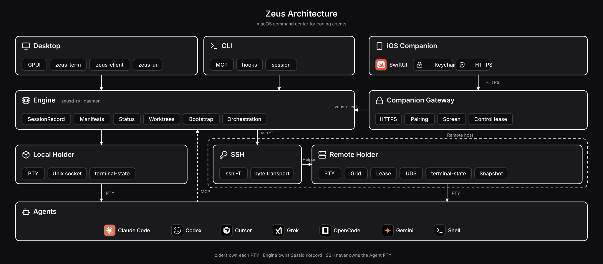

# How Zeus fits together

Zeus separates the thing you look at, the thing that decides, and the thing
that keeps the process alive:

- **Desktop app (`zeus`, GPUI).** The workbench: sidebar, terminal, inspector,
  review surfaces, palette. It renders state and sends commands; it does not
  own sessions. It verifies the Engine's explicit Rust identity during `Hello`
  and fails closed on missing, old, or unknown daemon identities.
- **Local Engine (`zeusd-rs`).** The authoritative session engine. It owns the
  session registry (`SessionRecord`), manifests, status reduction,
  project/worktree state, GUI events, orchestration, lifecycle policy, and
  host management. It talks to the app over a versioned local protocol.
- **Holders.** Sessions are owned by holder processes, not the Engine: the
  Engine can crash, upgrade, or be swapped out and every live agent keeps
  running, to be adopted by whatever Engine starts next. Locally this is
  `zeus-holder`; remotely it is a bootstrapped `zeus-remote` Helper.
- **Remote transport.** SSH is the authenticated, encrypted byte transport
  (`ssh -T`); the Helper owns the remote Agent PTY. There is no `tmux`,
  `screen`, or preinstalled service. See [Remote transport](remote-transport.md)
  and the authoritative
  [`zeus/REMOTE_PORT.md`](https://github.com/nnayz/zeus/blob/main/zeus/REMOTE_PORT.md).
- **Automation.** The `zeus` CLI provides hooks, notifications, the MCP
  backend, and session/worktree commands. Hosted agents reach the Engine
  through the injected MCP server. See [MCP, hooks, and automation](mcp-and-hooks.md).
- **Terminal state.** One shared parser produces the grid, snapshots, and
  diffs used by both the local Engine and the remote Holder
  (`zeus-terminal-state`); there is deliberately no second implementation.
- **Agent behavior as data.** Detection rules are JSON manifests under
  `zeus/crates/zeus-engine/manifests/`. See [Agent manifests](agent-manifests.md).

## Read the decisions where they live

Architecture decisions stay authoritative in their repository locations. This
book explains how to work with them:

- Remote session behavior, SSH handling, PTY ownership, holder lifecycle,
  terminal state, and packaging: `zeus/REMOTE_PORT.md`.
- Packaging and signing: `zeus/PACKAGING.md`.
- The auto-updater and release feed: `zeus/UPDATING.md`.
- The optional experimental Companion: `zeus/COMPANION_GATEWAY.md`,
  `zeus/COMPANION_TERMINAL.md`, and
  [Companion architecture and trust model](companion-architecture.md).

[Engineering documents](engineering-documents.md) indexes all of them with
their status.

## Historical records

Some documents in the repository are records of finished or superseded work.
They are kept for context and must not be read as current requirements:

- `zeus/PORT.md` — the port of the Engine from the retired Swift stack.
- `zeus/PLAN.md` — the GPUI client migration plan.
- `zeus/PERF.md`, `zeus/PERF-AUDIT.md` — dated measurements. They describe
  conditions at the time of the run; release acceptance comes from the
  packaged-artifact gates, not those numbers.

The completed remote refactor deleted the former Rust SSH + `tmux` transport.
It must not be reintroduced as a feature flag, migration path, or runtime
fallback.
